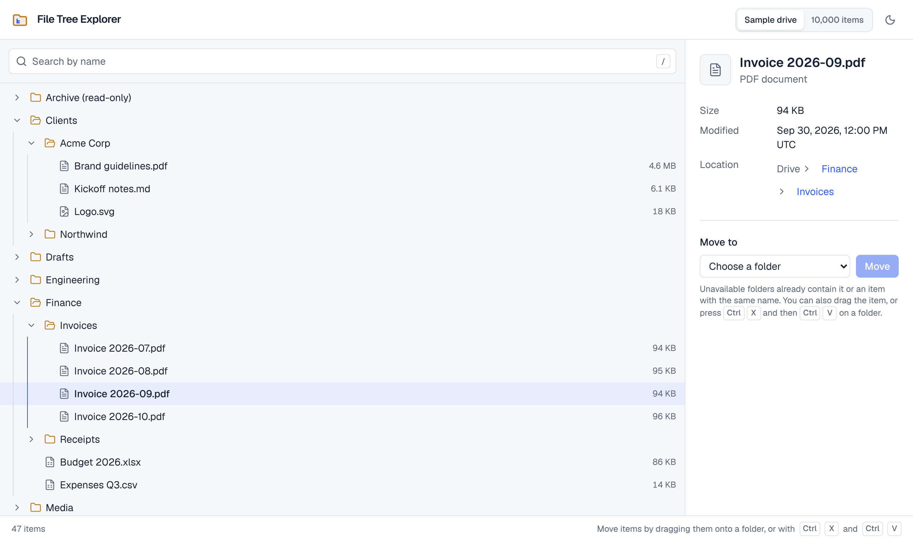

# File Tree Explorer

[](https://github.com/dianaasamkova/file-tree-explorer/actions/workflows/ci.yml)

A file manager's tree done properly: browse a drive with the keyboard or the mouse, find any file by name, and move items by drag and drop, cut and paste, or a "Move to" picker. Moves are optimistic and can be undone. It stays fast with 10,000 items.

<picture>
  <source media="(prefers-color-scheme: dark)" srcset="docs/screenshot-dark.png">
  
</picture>

**[Open the live demo](https://dianaasamkova.github.io/file-tree-explorer/)** · [Design system](https://dianaasamkova.github.io/file-tree-explorer/#design-system)

> Started in 2024 as a take-home assignment (a searchable tree in Create React App and MUI). Rebuilt in 2026 from scratch as a production-grade feature; [TECH.md](TECH.md) explains the decisions, trade-offs and measurements.

## Highlights

- **Accessible tree, built from scratch.** WAI-ARIA `tree` with one tab stop and `aria-activedescendant`, full keyboard support (arrows, Home/End, Page Up/Down, `*`, typeahead), a skip link, visible focus, and no axe violations in light and dark mode.
- **Three ways to move every item.** Native drag and drop (folders open when you hover them, the tree scrolls when you hold an item near its edge, and a refused drop says why), <kbd>Ctrl</kbd>/<kbd>⌘</kbd>+<kbd>X</kbd> and <kbd>V</kbd>, and a "Move to" picker. Dragging always has a keyboard and a single-pointer alternative (WCAG 2.2, 2.5.7).
- **Optimistic updates with rollback.** The tree changes at once; if the server refuses (try moving into "Archive (read-only)"), it rolls back and says why. Every move can be undone from the toast.
- **Search that keeps context.** Matches are highlighted, their folders open automatically, and a matching folder keeps its content. Clearing the search brings back the folders you had open. The count is announced to screen readers once you stop typing, not after every letter.
- **10,000 items, about 30 rows in the DOM.** The tree is flattened and virtualized; search runs at a lower priority with `useDeferredValue`, so typing stays responsive.
- **Shareable state.** The search, selected file and drive live in the URL (`?q=…&file=…&dataset=large`).
- **Light and dark themes designed together**, following the system setting until you choose, with no flash on load.
- **Organised like a product team's codebase.** A monorepo with a design system package (`@fte/ui`), a feature package (`@fte/file-tree`) and the app, with dependency rules enforced by lint, a page that shows every token and component, and builds and tests cached by Turborepo.
- **Tested:** 160 unit and component tests. Coverage is 100% today; CI requires 100% for the data logic and 95% elsewhere. A Playwright suite covers keyboard use, drag and drop, the 10,000-item drive and accessibility.

## Tech stack

React 19 · TypeScript 6 (strict) · Vite 8 · Tailwind CSS 4 with shadcn/ui-style components · TanStack Query · TanStack Virtual · Vitest + Testing Library · Playwright + axe · npm workspaces + Turborepo · GitHub Actions and Pages

## Quick start

Requires Node 22+.

```bash
npm ci
npm run dev        # http://localhost:5173
```

The backend is an in-browser mock with 400 ms of latency, so loading states and optimistic updates are visible. Add `?latency=0` to the URL to turn it off. Changes reset on reload.

## Scripts

Run them from the repository root; Turborepo runs each package's task and caches the result.

| Script                  | What it does                                       |
| ----------------------- | -------------------------------------------------- |
| `npm run dev`           | Development server for the demo app                |
| `npm run build`         | Production build                                   |
| `npm run preview`       | Serve the production build                         |
| `npm test`              | Unit and component tests in every package          |
| `npm run test:coverage` | Tests with each package's coverage thresholds      |
| `npm run test:e2e`      | Playwright tests against the production build      |
| `npm run typecheck`     | TypeScript in every package                        |
| `npm run lint`          | ESLint, including the rules for package boundaries |
| `npm run format`        | Prettier (with class sorting for Tailwind)         |

Before the first e2e run: `npx playwright install chromium`.

## Project structure

```
apps/web/                      # The demo app
├── src/components/            # App shell: header with drive switch, theme and page link
├── src/pages/                 # Design system page (#design-system)
└── e2e/                       # Playwright: keyboard, drag and drop, large drive, accessibility
packages/
├── ui/                        # @fte/ui, the design system
│   └── src/
│       ├── components/        # Button, Kbd, Skeleton
│       ├── tokens/            # Colour roles: CSS variables (light and dark) and their TypeScript names
│       └── lib/               # cn(), platform helpers
├── file-tree/                 # @fte/file-tree, the feature
│   └── src/
│       ├── model/             # Pure domain logic, no React: tree, move rules, search, formatting
│       ├── api/               # The contract with the backend, its React context and the Query hooks
│       ├── server/            # The in-browser mock backend and its datasets
│       ├── state/             # UI-state reducer: expanded, selected, focused, cut
│       ├── hooks/             # URL state, debounced values
│       ├── ui/
│       │   ├── explorer/      # The screen: layout, search box, status bar, loading/empty/error states
│       │   ├── tree/          # Virtualized tree: view, row, keyboard model, drag and drop
│       │   ├── details/       # Details panel and the Move to form
│       │   └── shared/        # File icons, match highlighting
│       └── testing/           # Render helpers and fixtures, exported as @fte/file-tree/testing
└── config/                    # Shared TypeScript and Vitest settings
docs/specs/                    # Specs for upcoming work
```

Dependencies only point down: the app uses the feature and the design system, the feature uses the design system, and the design system uses neither. Packages are imported only through their entry points.

## Docs

[TECH.md](TECH.md): problem and acceptance criteria, architecture, decisions and trade-offs, accessibility, testing strategy, bundle size before and after, a retrospective and a roadmap.
