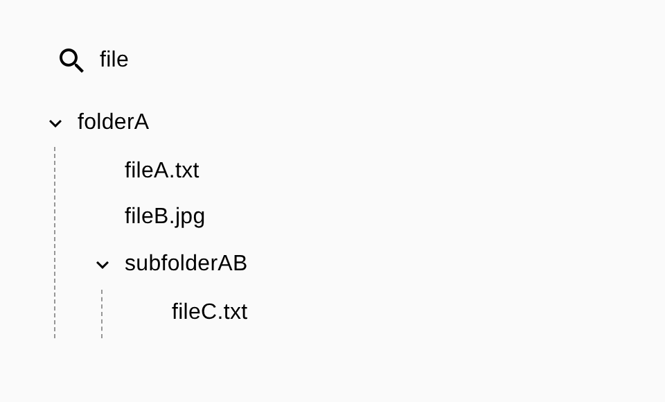

# File Tree Explorer

[](https://github.com/dianaasamkova/spendbase/actions/workflows/ci.yml)

A searchable file-and-folder tree in React: nested folders, multi-select, and a search that keeps the path to every match.



> **Context:** a 2024 take-home assignment. I revisited it in 2026, fixed a search bug, added tests and CI, and documented the design decisions and what I'd change. See [TECH.md](TECH.md).

## Highlights

- **Search that keeps context.** Files match by name, and their parent folders stay visible, so the user always sees _where_ a match lives. A folder that matches by name keeps all of its contents.
- **Auto-expand on search.** Results open automatically, so matches are never hidden inside collapsed folders.
- **Debounced input.** The input updates on every keystroke, but the tree filters only after the user stops typing.
- **Pure, tested logic.** Search and id-collection are plain recursive functions, separate from the UI and covered by unit tests.
- **Typed data contract.** `Folder | File` is a discriminated tree type that mirrors the backend response.

## Tech stack

React 18 · TypeScript · MUI 5 + MUI X Tree View 7 · Jest + Testing Library · Create React App

## Quick start

Requires Node 18+ and Yarn 1.

```bash
yarn install
yarn start        # http://localhost:3000
yarn test         # unit tests
yarn build        # production build
```

The data comes from a local mock, [`src/components/tree/response.json`](src/components/tree/response.json), so no backend is needed.

## Project structure

```
src/components/
├── search/           # Search input (MUI InputBase)
└── tree/
    ├── index.tsx       # TreeView: state, debounced search, expand/select
    ├── handlers.tsx    # buildTree, searchFolders, getFoldersAndFilesIds (pure)
    ├── handlers.spec.ts
    ├── definitions.ts  # Folder / File / BackendResponse types
    ├── styles.ts       # Styled TreeItem with guide lines
    └── response.json   # Mock backend response
```

## Docs

- [TECH.md](TECH.md): architecture, decisions and trade-offs, a 2026 retrospective, and a roadmap.
