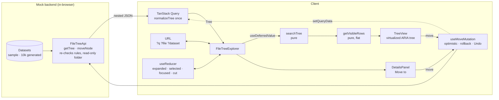

# File Tree Explorer: Technical Notes

## 1. Problem

People keep work in nested folders and need to find a file fast and put things where they belong. The 2024 version of this project only searched; this one is a complete feature a product team could ship.

**Acceptance criteria**

- Folders and files render as a tree with any depth, folders first, names in natural order ("v2" before "v10").
- Search filters by name, case-insensitively. Each match is shown with the folders that contain it, highlighted, and its folders are open. A matching folder keeps all its content. Clearing the search restores the folders the user had open.
- Any item can be moved into another folder or to the root by drag and drop, by keyboard (cut and paste), and with a single pointer (a "Move to" picker). Invalid moves are refused with a reason: into itself, into its own subfolder, into its current folder, or next to an item with the same name.
- A move shows at once. If the server refuses, the tree goes back and the user is told why. A successful move can be undone.
- Selecting an item shows its type, size, date, location and, for a folder, totals of what it contains.
- It works with the keyboard alone and with a screen reader, in light and dark mode, and on a phone.
- It stays responsive with 10,000 items.
- Loading, empty, no-results and error states each tell the user what to do next.

## 2. Architecture

- **`model/`** is plain TypeScript with no React: normalizing the API response, move rules, search and the flattening of the tree into rows. It's where the logic lives and where most tests are.
- **`api/`** holds the backend contract (`FileTreeApi`), an in-memory implementation, and the Query hooks. The UI gets the client through context, so tests and the demo inject their own.
- **`state/`** is one typed reducer for UI state.
- **`ui/`** components take data and callbacks; `FileTreeExplorer` is the only one that wires state together.

### Data model

The backend sends a nested tree, as most file APIs do. The client normalizes it once into `{ rootIds, nodes }`: a flat map by id, with each folder holding sorted `childIds` and each node its `parentId`. Moves, ancestor lookups and path building are then O(1) or O(depth), and an immutable move only copies the three objects it touches. The root has no node of its own; a move target is `FolderTarget = id | null`.

To render, `getVisibleRows` walks the tree once into a flat list of the rows on screen, with the ARIA level, position and set size each row needs. A flat list is what makes virtualization possible.

## 3. Key decisions

| Decision                                                              | Why                                                                                                                                                                                                                        | Trade-off                                                                                                                                                               |
| --------------------------------------------------------------------- | -------------------------------------------------------------------------------------------------------------------------------------------------------------------------------------------------------------------------- | ----------------------------------------------------------------------------------------------------------------------------------------------------------------------- |
| **No global store** (no Redux or Zustand)                             | The state splits cleanly by kind: server data in TanStack Query, UI state local to one screen in a reducer, shareable state in the URL. Nothing else reads it, so a store would add indirection without solving a problem. | If several screens need the selection later, the reducer moves into context; it's already one typed unit.                                                               |
| TanStack Query for the tree                                           | Caching per dataset, loading and error states, cancelation, and a standard pattern for optimistic updates with rollback.                                                                                                   | One more dependency (10.6 KB gzipped).                                                                                                                                  |
| Optimistic moves, rollback, Undo in the toast                         | Moving should feel instant. Rollback keeps the UI honest when the server says no; Undo makes a mistaken drop cheap.                                                                                                        | Two quick moves where the first fails roll back to the first one's snapshot; the refetch after every move puts the tree right again.                                    |
| Server re-checks every rule and owns one rule the client doesn't know | Client checks are only for fast feedback. The read-only "Archive" folder makes rollback visible in the demo.                                                                                                               | —                                                                                                                                                                       |
| Search-mode expansion kept apart from the user's own                  | Search opens many folders; dropping that on clear brings back exactly what the user had open.                                                                                                                              | Two sets of expansion state in the reducer.                                                                                                                             |
| `useDeferredValue` instead of a debounce                              | Input never lags and results show as soon as React has time, with no fixed delay.                                                                                                                                          | Filtering runs on every keystroke, at low priority: about 4–6 ms per search over 10,000 names. A debounce only pays off when search becomes a server request (v2 spec). |
| Own tree instead of a tree library                                    | Full control over ARIA, keyboard, drag and drop and virtualization, which tree libraries rarely combine; and a much smaller bundle than MUI X Tree View.                                                                   | More code to own and test (about 300 lines for the tree).                                                                                                               |
| `aria-activedescendant` with a flat, virtualized list                 | One tab stop, and it works when the focused row isn't in the DOM yet.                                                                                                                                                      | The focused row has to be scrolled into view so it exists; done on every focus change.                                                                                  |
| Native HTML5 drag and drop                                            | No dependency; the browser handles the drag image and cursor.                                                                                                                                                              | No touch support; on touch the picker and cut and paste are the way to move. Browsers don't scroll a panel during a drag, so the tree scrolls itself near its edges.    |
| Tailwind 4 + shadcn/ui-style components written by hand               | Semantic tokens for light and dark, and only the few primitives this screen needs.                                                                                                                                         | Hand-written rather than generated, so there's no CLI to update them.                                                                                                   |
| Natural sort with `Intl.Collator`                                     | "Invoice 2" before "Invoice 10", case-insensitive, as file managers do.                                                                                                                                                    | —                                                                                                                                                                       |
| URL as the share format                                               | A search or a selected file can be sent as a link; `replaceState` keeps typing out of the history.                                                                                                                         | Only `q`, `file` and `dataset` are kept; expansion isn't.                                                                                                               |

## 4. Accessibility

- **Pattern:** WAI-ARIA tree view with a flat list of `treeitem`s carrying `aria-level`, `aria-posinset`, `aria-setsize`, `aria-expanded` and `aria-selected`. The tree is one tab stop; arrows move `aria-activedescendant`.
- **Keyboard:** ↑ ↓, Home, End, Page Up and Down; → opens a folder or goes to its first child; ← closes it or goes to the parent; Enter selects and toggles a folder; Space selects; `*` opens all sibling folders; typing jumps to a matching name; <kbd>Ctrl</kbd>/<kbd>⌘</kbd>+<kbd>X</kbd> and <kbd>V</kbd> cut and paste; Esc cancels a cut; `/` focuses the search.
- **Dragging has alternatives** (WCAG 2.2, 2.5.7): cut and paste for the keyboard, the "Move to" picker for a single pointer. Folders the item can't go to are disabled in the picker.
- **Announcements:** the status bar's count is a polite live region. The visible count follows every keystroke, but the announced one waits until typing pauses for 500 ms, so typing "invoice" is one announcement, not seven; toasts announce moves and errors; the error state is an `alert`.
- **Visuals:** text contrast is at least 4.5:1 and icons and focus rings at least 3:1 in both themes; focus is always visible; rows are 32 px high and the chevron's target is 24 px; motion is limited to small transitions and turned off with `prefers-reduced-motion`.
- **Checked by** axe in Playwright (WCAG 2.0, 2.1 and 2.2 A and AA rules) in light and dark mode, plus manual keyboard testing.

## 5. Testing strategy

| Layer      | Tool                                  | What                                                                                                                                                                                                                                              | Count |
| ---------- | ------------------------------------- | ------------------------------------------------------------------------------------------------------------------------------------------------------------------------------------------------------------------------------------------------- | ----- |
| Unit       | Vitest                                | Normalizing, sorting, move rules, search, row flattening, formatting, the dataset generator, the mock server, the reducer                                                                                                                         | 108   |
| Component  | Vitest + Testing Library + user-event | The whole app against the in-memory server with no latency: keyboard, typeahead, search, details, Move to, cut and paste, drag and drop with a `dataTransfer` mock, optimistic rollback with a controlled promise, Undo, URL, theme, drive switch | 47    |
| End to end | Playwright                            | Production build in Chromium: keyboard-only flow from the skip link, real drag and drop with rollback, scrolling 10,000 items, auto-scroll while dragging, axe in both themes                                                                     | 6     |

Coverage is 100% for statements, branches, functions and lines, and CI fails below that. Only test files are excluded. Getting there removed code rather than adding contrived tests: guards for states that can't happen were designed out (the loaded explorer is a separate component that always has a tree), and the remaining gaps were real behavior: an empty drive, a failed background refresh, a retry, Alt shortcuts, the ⌘ label on a Mac. Component tests use the real sample drive, so they read like the product ("drag Welcome.md onto Drafts") rather than like fixtures. jsdom has no layout, so the setup file gives elements a size and mocks `ResizeObserver` for TanStack Virtual.

## 6. Bundle size

Production build, JavaScript, gzipped. The 2024 numbers are from the last Create React App build.

|                         |                        2024: CRA + MUI |                                                     2026: Vite + Tailwind |
| ----------------------- | -------------------------------------: | ------------------------------------------------------------------------: |
| Total JS                |                 **88 KB** (271 KB raw) |                                                   **123 KB** (395 KB raw) |
| UI library              | ~45 KB (MUI, Emotion, MUI X Tree View) | ~22 KB (sonner 9.4, tailwind-merge 8.6, lucide icons 3.2, cva + clsx 0.6) |
| Tree                    |                           inside MUI X |                                                                  own code |
| React                   |       React 18 + app: the other ~43 KB |                                               React 19 (react-dom): 68 KB |
| Data and virtualization |                                      — |                                TanStack Query 10.6, TanStack Virtual 10.1 |
| App code                |                 inside the 43 KB above |                                                                   13.3 KB |
| CSS                     |                    Emotion, at runtime |                                                            5.8 KB, static |

To be honest about it: the bundle grew by 35 KB. The UI layer halved (45 → 22 KB) even though the app does far more, but React 19's react-dom alone is 68 KB, and caching, optimistic updates and virtualization add 21 KB of real features. The cheapest further cuts would be dropping `tailwind-merge` (8.6 KB) for plain `clsx`, and lazy-loading the toast library.

## 7. Looking back

What the 2024 version taught me, and what changed:

- **The bug that started the rewrite:** a folder that matched by name lost its children, because they were filtered by the same query. Search is now a pure function with a test for that case.
- **Empty folders looked like files** because `children: []` was treated as a leaf. Nodes now carry their `type`, and an empty "Drafts" folder is in the sample data on purpose.
- **Clearing a search left everything expanded.** Search expansion is now separate state, dropped on clear.
- **A 1000 ms debounce felt slow.** `useDeferredValue` removes the fixed delay.
- **MUI X rendered every node.** A flat row model plus virtualization keeps the DOM at about 30 rows for any size.
- **What I'd still change:** drag and drop has no touch support (the picker covers it), the URL doesn't keep expanded folders, and two fast moves where the first fails rely on the refetch to settle.

## 8. Roadmap

1. **Lazy loading per folder** with `useInfiniteQuery`, so a drive doesn't have to arrive in one response; search moves to the server.
2. **Multi-select** (Shift and Ctrl click, Shift+arrows) and moving several items at once.
3. **Rename, create and delete**, with the same optimistic pattern and Undo.
4. **Touch drag and drop** through pointer events, keeping native DnD for desktop.
5. **Move the read-only rule into the client's knowledge** once the API exposes permissions, so invalid drops are refused before they're tried.
