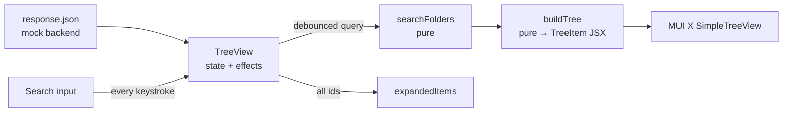

# File Tree Explorer: Technical Notes

## 1. Problem

Show a user's files as a nested folder tree and let them find a file fast, even when it sits several levels deep.

**Acceptance criteria**

- Folders and files render as an expandable tree, with any depth of nesting.
- Typing in search filters the tree by name, case-insensitively.
- A matching file is shown together with the folders that contain it.
- Results are expanded, so matches are visible without clicking.
- When nothing matches, the user sees "Nothing found".

## 2. Architecture

- **`TreeView`** owns the state: raw folders, input value, debounced query, and the expanded and selected item ids.
- **`handlers.tsx`** holds the logic as pure functions: filter the tree, collect ids, map data to `TreeItem` elements. They're easy to unit-test and to move to a worker or the backend later.
- **`SimpleTreeView`** (MUI X) is used in controlled mode, so search can drive expansion.

## 3. Key decisions

| Decision                              | Why                                                                  | Trade-off                                                 |
| ------------------------------------- | -------------------------------------------------------------------- | --------------------------------------------------------- |
| MUI X `SimpleTreeView`                | Keyboard navigation, ARIA tree roles and multi-select out of the box | Renders every node; there's no built-in virtualisation    |
| Filter on the client                  | The dataset is small and comes in one response                       | Doesn't scale to large drives (see Roadmap)               |
| Keep ancestors of matches             | A file name alone is ambiguous; the path gives context               | The visible tree can still be large for common queries    |
| Matching folder keeps all its content | The user searched for the folder, so they want what's inside         | Its children aren't narrowed further                      |
| Two states: `inputValue` and `search` | The input stays responsive; only the expensive filter is debounced   | Two sources of truth to keep in sync                      |
| Expand everything while searching     | Matches are never hidden in a collapsed branch                       | It also expands non-matching branches of matching folders |
| `memo` on the filtered tree           | Avoids re-filtering on selection or expansion changes                | —                                                         |

### Data model

The mock response mixes folders and files in one `children` array. For a real backend, I'd store folders and files in separate tables (an adjacency list with `parent_id`, or a materialized path for fast subtree queries) and have the API return one level at a time.

## 4. Quality

- **Tests:** unit tests for `searchFolders` (file match, folder match, case-insensitivity, no match) and `getFoldersAndFilesIds`; a smoke test for `App`.
- **CI:** GitHub Actions runs install, tests and a production build on every push and pull request.
- **Accessibility:** MUI X Tree View provides `role="tree"` / `treeitem`, arrow-key navigation and `aria-expanded`. The search input has an `aria-label`.

## 5. Looking back (2026)

What I'd do differently today:

- **Fixed in 2026:** a folder that matched by name lost all its children, because they were filtered against the same query. It now keeps its content, and there's a test for it.
- **Empty folders look like files.** `children: []` is treated as a leaf, so there's no folder icon or expand affordance. I'd use the `type` field and render icons per type.
- **Collapse state after search.** Clearing the search leaves everything expanded. I'd snapshot `expandedItems` before the search and restore it after.
- **Debounce of 1000 ms** feels slow; 200–300 ms is closer to "instant". I'd also move the query to the URL, so a search is shareable.
- **Highlight the match** inside each label, so the user sees why an item is there.
- **Tooling:** today I'd use Vite and Vitest instead of Create React App, which is deprecated.

## 6. Roadmap

1. **Scale:** virtualised rendering (e.g. `react-window`) and lazy loading of folder children per level.
2. **Server-side search** with pagination once the tree no longer fits in one response.
3. **File details:** size, type icon and a preview panel on selection.
4. **Actions:** rename, move by drag and drop, delete, with optimistic updates.
5. **Keyboard search:** `/` focuses search, `Esc` clears it.
